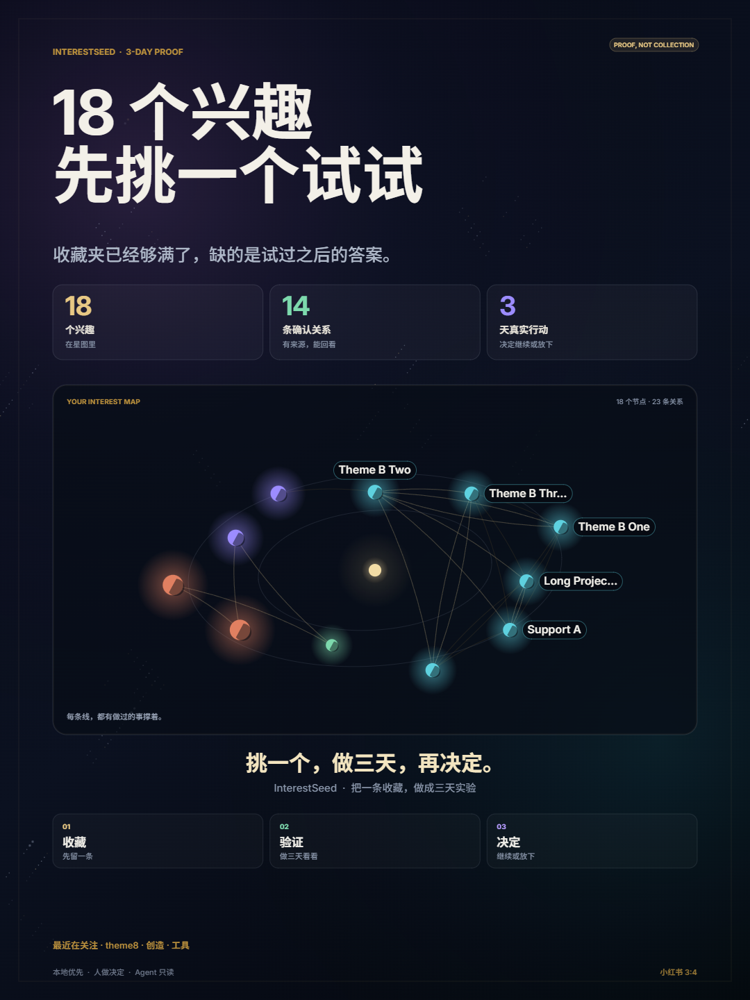
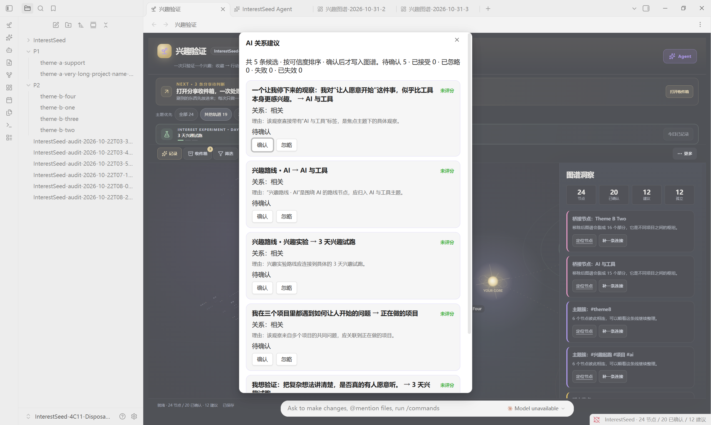
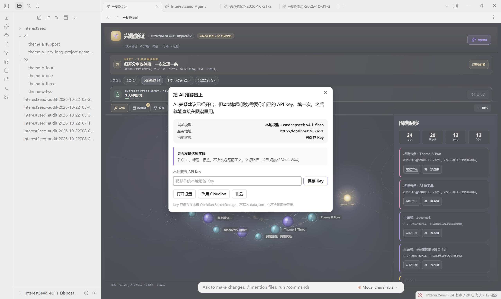

<div align="center">

<a href="assets/interestseed-launch.mp4"></a>

<h1>InterestSeed</h1>

<p><strong>An interest validator for Obsidian</strong></p>

<p>Turn one saved post into a real 3-day action.<br/>Then let evidence decide: keep it, or let it go.</p>

<p>
  <a href="assets/interestseed-launch.mp4"></a>
  
  
  
  
  
</p>

<p>
  <a href="README.md">简体中文</a> ·
  <a href="assets/interestseed-launch.mp4">40s demo</a> ·
  <a href="docs/tutorial.md">Tutorial</a> ·
  <a href="docs/positioning.md">Positioning</a> ·
  <a href="https://github.com/lxc248/-interestseed/releases">Download</a>
</p>

</div>

---

> Most tools help you **save it**.  
> InterestSeed helps you **test it**.

We don't lack bookmarks. We lack the part after saving: actually trying it once, then saying honestly, "worth keeping" or "let it go."

## Where it differs from a bookmark pile

| | Bookmarks | Bidirectional notes | **InterestSeed** |
| --- | --- | --- | --- |
| Question | Where is it? | What is it linked to? | **Is it worth doing?** |
| Success metric | Items collected | Links created | **One real test completed** |
| End state | To read | A graph | **Keep / drop + next action** |
| Default action | Save | Link | **Run a small experiment** |

Bookmarks solve "don't lose it." InterestSeed tries to solve "don't pretend you'll do it."

It does not optimize node count. It optimizes **decision completion**.

## How it actually runs

One piece of content comes in. It gets one path.

```text
Capture → Decide → Connect → Verify → Review → Next action
```

| Stage | What happens |
| --- | --- |
| **Capture** | A Share Inbox takes short-video links, article excerpts, or notes. One item at a time. |
| **Decide** | Keep and connect, or pass. Passing is a valid decision, not a failure. |
| **Connect** | A kept spark joins an existing interest or starts a new one. |
| **Verify** | A 3-day starter experiment records one real action per day. |
| **Review** | An append-only Observation Timeline stores evidence and belief direction. |
| **Next action** | An explicit Markdown Interest Route states status, evidence, and the next step. |

The graph is not the product. It is the evidence layer that makes each decision inspectable.

## What it looks like

Six screenshots, and you basically know what it does.

<table>
  <tr>
    <td width="50%">
      <br/>
      <sub><b>3-minute cold start</b>: you do not need to know what you like first.</sub>
    </td>
    <td width="50%">
      <br/>
      <sub><b>3-day experiment</b>: one real piece of evidence per day, no fake progress.</sub>
    </td>
  </tr>
  <tr>
    <td width="50%">
      <br/>
      <sub><b>Cosmic graph</b>: nodes, orbits, bridges, and the next step.</sub>
    </td>
    <td width="50%">
      <br/>
      <sub><b>Local share cards</b>: five platform presets, rendered on Canvas.</sub>
    </td>
  </tr>
  <tr>
    <td width="50%">
      <br/>
      <sub><b>AI relation suggestions</b>: candidates with reasons, written only after confirmation.</sub>
    </td>
    <td width="50%">
      <br/>
      <sub><b>Connect your own AI</b>: keys in local secret storage, model configurable.</sub>
    </td>
  </tr>
</table>

## What you will actually use

These aren't a feature checklist. They're the moves I actually make every day.

| Capability | What it does |
| --- | --- |
| **One at a time** | Share Inbox with list and focus modes; `←` pass, `→` keep. No batch processing. |
| **Source provenance** | Every item stores source, sourceRef, capturedAt, and status; links return to the note or URL. |
| **Task state** | `captured → judged → connected → experimenting → reviewed`, derived deterministically. |
| **Observation Timeline** | Append-only evidence with `stronger / weaker / changed`, capped at 40 entries. |
| **3-day verification** | A time-boxed experiment that records what actually happened. No auto-completion. |
| **Context Search** | Deterministic multi-field search across title, tags, summary, why, raw text, source, and evidence. No embeddings. |
| **Interest Route** | An explicit Markdown MOC generated on command. It never writes notes automatically. |
| **Five share cards** | Xiaohongshu, Instagram, X, WeChat, and Story, rendered locally on Canvas. |
| **AI relation suggestions** | On by default; a setup window connects your own key; default model `cn:deepseek-v4.1-flash`, model ID is configurable; sends only node id, title, and tags |
| **MCP interface** | Zero-dependency read-only MCP server, protocol `2026-07-28`. |
| **Adaptive layout** | Desktop, narrow, and very narrow panes with icon-first actions and no horizontal overflow. |

## Install it

It takes about three minutes.

1. Download `interestseed-v3.4.1.zip` from [Releases](https://github.com/lxc248/-interestseed/releases).
2. Extract it into:

```text
<your-vault>/.obsidian/plugins/interestseed/
```

3. Confirm `main.js`, `manifest.json`, and `styles.css` are present.
4. Obsidian → Settings → Community plugins → enable **InterestSeed**.
5. Run the cold-start questionnaire, or record a spark.
6. Process the Share Inbox, then start a 3-day experiment.

Full walkthrough: [docs/tutorial.md](docs/tutorial.md)

## MCP

```bash
node mcp/server.mjs --graph "<vault>/.obsidian/plugins/interestseed/graphs/default.json"
```

```text
tools:      interestseed_get_graph / next_step / search_interest / get_experiment / get_context
resources:  interestseed://graph / experiment / next / context
prompts:    review-interest / plan-next-experiment
```

The MCP surface is read-only. Core functionality needs no account or model credentials.  
AI relation suggestions are on by default and only call the selected model when you ask. A setup window lets you connect your own local service key, and the model ID can be changed in settings; it lives in Obsidian SecretStorage, never in data.json. If unavailable, local rule discovery stays intact.  
Live run: cn:deepseek-v4.1-flash returned 5 focused candidates; a confirmed relation carried its reason into edge evidence.

## How stable it is

These numbers are not decoration. I rerun them after every change.

```text
522 tests passing
75.16% line coverage
92.25% core coverage
43.97% UI coverage
axe: graph / inbox / share-card 0 violations
semgrep: 0 findings
gitleaks: no leaks
CI + Release: green
```

```bash
npm install
npm run verify      # typecheck + tests + lint + build
npm run coverage
node --test mcp/smoke.test.mjs
```

Requires Node.js 22+.

## A few principles I won't trade away

```text
Human-in-the-loop
Local-first
Explicit over automatic
Evidence over volume
Deterministic retrieval
```

InterestSeed does not scrape platforms, store cookies, auto-publish, auto-write the graph, or auto-generate routes.  
The user keeps the decision rights.

## Documentation

| Document | Contents |
| --- | --- |
| [docs/architecture.md](docs/architecture.md) | Module map, data flow, invariants, extension points |
| [docs/tutorial.md](docs/tutorial.md) | End-to-end tutorial |
| [docs/positioning.md](docs/positioning.md) | Positioning and competitive analysis |
| [docs/seed-sprint.md](docs/seed-sprint.md) | Cold-start design |
| [docs/view-modes.md](docs/view-modes.md) | Graph / inbox / discovery invariants |
| [docs/context-packet.md](docs/context-packet.md) | Data model and task state |
| [docs/share-cards.md](docs/share-cards.md) | Share-card export behavior |
| [docs/commands.md](docs/commands.md) | Command palette reference |
| [SECURITY.md](SECURITY.md) | Security model and disclosure |

## License

AGPL-3.0-only. Author: [aicoder](https://github.com/lxc248).

If you have ever saved something and quietly known you would never try it, this is for you.  
Star it if it helps. Open an issue if it doesn't. If you want to improve it, start with [CONTRIBUTING.md](CONTRIBUTING.md) and [CODE_OF_CONDUCT.md](CODE_OF_CONDUCT.md).


