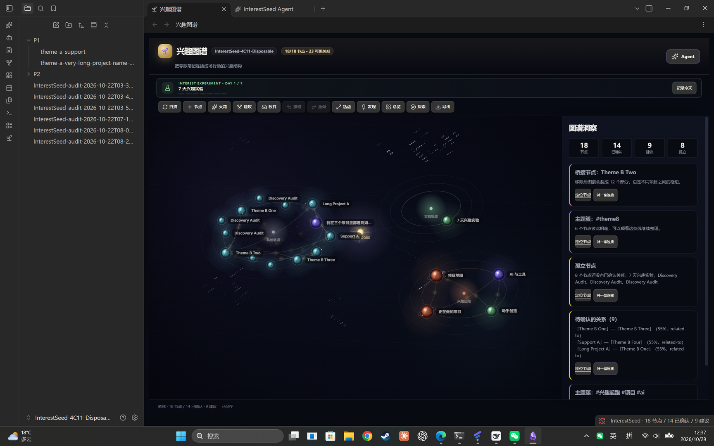
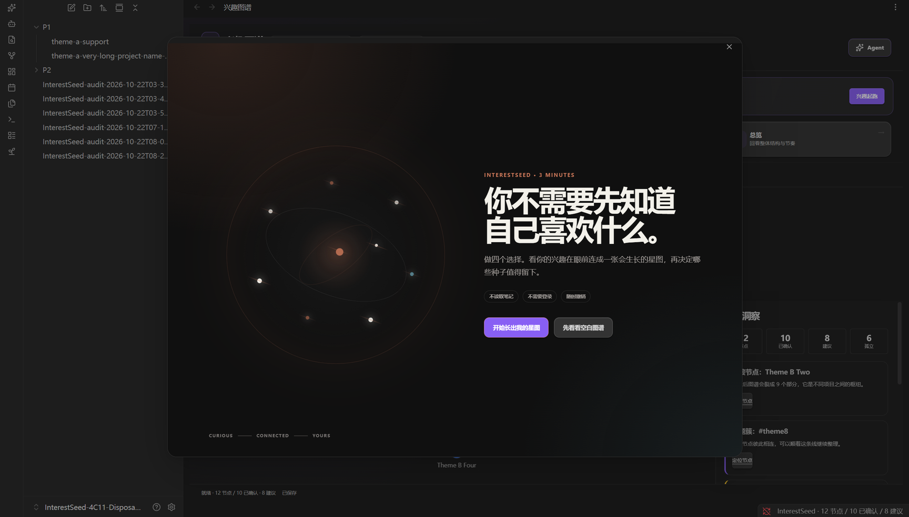
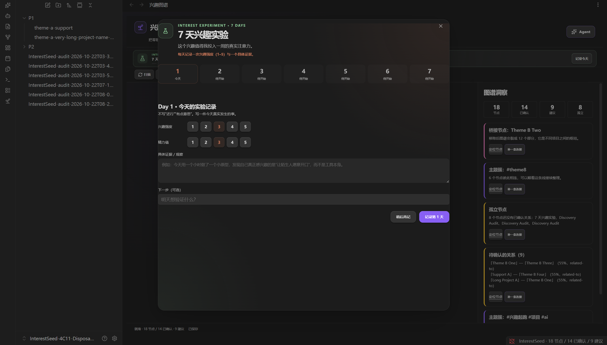
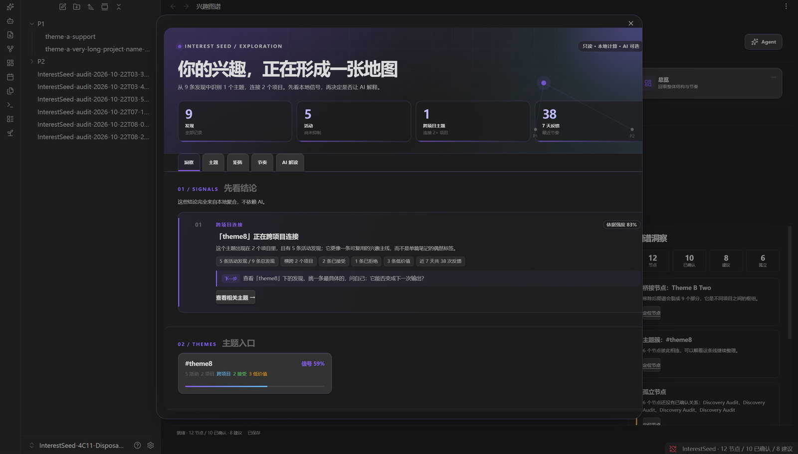
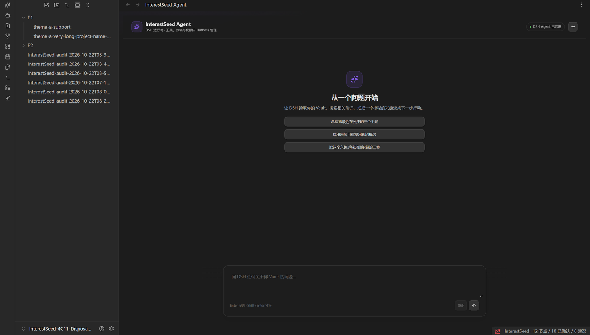

# InterestSeed

**你不需要先知道自己喜欢什么。做四个选择，长出第一张会生长的兴趣星图。**

[简体中文](README.md) · [English](README.en.md) · [看 40 秒演示](assets/interestseed-launch.mp4) · [产品设计](docs/seed-sprint.md)

[](assets/interestseed-launch.mp4)

<p>
  
  
  
  
  
</p>

---

## 这不是又一个 AI 笔记插件

大多数兴趣工具让你：

```text
打开空白输入框 → 想不出写什么 → 关掉
```

InterestSeed 让你：

```text
做四个具体选择
→ 看见第一张兴趣星图
→ 确认哪些种子值得留下
→ 领一个 7 天兴趣实验
→ 让图谱在真实行动里继续生长
```

它把 **短视频时代的一次短暂好奇**，变成一张可确认、可追溯、可行动的兴趣图谱。

---

## 3 分钟，从 0 到 1

### 01 · 四个选择，不写长文

不是问“你对什么感兴趣”，而是给你具体的场景卡片：

```text
现在的你，更接近哪种状态？
什么最容易让你忘记时间？
最近什么内容最容易让你停下来？
你希望这张图先长成什么？
```

### 02 · 看见兴趣开始有形状

选完后，InterestSeed 生成一张 **草稿星图**：

- 5 个种子节点；
- 4–6 条带证据的候选连接；
- 1 个“意外连接”；
- 1 个未解锁的神秘方向；
- 1 个可以马上开始的 7 天兴趣实验。

### 03 · AI 提案，不替你决定

每条关系都有：

```text
证据 · 置信度 · 来源 · 状态
```

草稿默认不写回图谱。你可以逐项保留、删除、修改；写入后仍然可以撤销。

---

## 四个让它持续生长的入口

| 入口 | 作用 |
| --- | --- |
| **兴趣起跑** | 4 个选择，生成第一张可确认图谱 |
| **兴趣火花** | 粘贴短视频链接或一句话，留下一个种子 |
| **图谱缺口教练** | 从孤立节点和桥接节点出发，补一条真实连接 |
| **7 天兴趣实验** | 把兴趣变成行动，把行动反馈回图谱 |

```text
短暂好奇
   ↓ 火花
候选种子
   ↓ 确认
兴趣星图
   ↓ 缺口教练
新连接
   ↓ 7 天实验
真实反馈
   ↓
下一张更懂你的星图
```

---

## 为什么它与众不同

| 常见 AI 图谱 | InterestSeed |
| --- | --- |
| AI 自动生成、自动写回 | **先提案，后确认；默认不写回** |
| 只给“相关” | 每条边有 `origin`、`status`、`confidence`、`evidence` |
| 拒绝后下次继续推荐 | 反馈记忆 + 抑制键，减少重复打扰 |
| 只服务已有笔记 | 从 0 开始，用选择卡完成冷启动 |
| 收藏夹越来越大 | 火花捕获把消费转成图谱结构 |
| 图谱只是结果页 | 图谱旁边有缺口、下一步、实验和 Agent |
| 聊天是主界面 | 图谱是主界面，Agent 是执行层 |

核心原则：

> **AI 负责提出候选，人负责确认，反馈负责让下一轮更聪明。**

---

## 产品截图

### 主工作区


### 宇宙星图（插件内默认）



打开 InterestSeed 就是一张个人宇宙：中心是星核，外围是主题行星系统，行星是兴趣，金色星座线是关系。参考了 `neural-creator-dashboard` 的视觉结构，但没有照搬成“神经网络节点”，而是保留行星的实体感与轨道语法。

选中、拖拽、缩放、筛选、详情面板都在 Obsidian 内完成。单文件 HTML Viewer 只作为 Agent Skill 的便携输出，不是主体验。

### 兴趣起跑



### 严谨的 7 天实验



不是点一下加一天：每天必须写下真实观察，记录兴趣强度与精力值，连续 7 条才完成。

### 兴趣探索



### 连接自己的 Agent



---

## 安装

### 手动安装

1. 下载最新 Release 的 `interestseed-v1.0.0.zip`；
2. 解压到：

```text
<你的 Vault>/.obsidian/plugins/interestseed/
```

3. 确认目录内有：

```text
main.js
manifest.json
styles.css
```

4. 在 Obsidian 设置 → 第三方插件中启用 InterestSeed。

### 不安装 Obsidian

[下载 `interestseed-skill-v1.0.0.zip`](https://github.com/lxc248/-interestseed/releases/download/v1.0.0/interestseed-skill-v1.0.0.zip)，放入用户 Agent 的 skills 目录，阅读 `skill/SKILL.md`。Agent 会生成一个独立的 `star-map.html`，双击即可查看行星、轨道和星云；不需要 Obsidian。

### 从源码构建

```bash
npm install
npm run build
npm run deploy
```

要求 Node.js 20+。

### 开发校验

```bash
npm run verify
```

包含 typecheck、447 个测试、ESLint 与生产构建。

---

## 连接自己的 Agent

InterestSeed 不绑定模型平台，也不托管你的模型凭据。

```text
InterestSeed UI
    → DSH ACP / 你的 Agent 命令
    → ACP v1
    → 你的模型、工具、沙箱、权限
```

设置页配置：

```text
启用 DSH Agent
DSH 命令
DSH profile（默认 acp）
DSH 模型
```

Agent 工作目录是当前 Vault。InterestSeed 只负责会话、工具卡、权限卡和任务可视化；DSH 自己管理模型与 Key。

---

## 本地优先与隐私

- 默认不读取笔记正文；
- AI 数据发送必须显式授权；
- 火花只保存你主动粘贴的文本/链接；
- 图谱、反馈和实验进度保存在本地 Vault；
- 所有写入经过可撤销的 GraphSession；
- 没有 Agent 也能完整使用图谱、发现和探索。

---

## 目录

```text
src/
  onboarding/     兴趣起跑引擎
  ui/             SeedSprint / Spark / GapCoach / Agent / Graph
  core/           图谱、关系、洞察、撤销
  discovery/      发现生命周期与反馈
  storage/        持久化、迁移、恢复
  plugin/         命令与控制器
docs/
  seed-sprint.md  产品机制
  short-video.md  短视频脚本
  launch.md       发布与传播计划
promo/
  index.html      纯代码宣传片
  render.mjs      Playwright → FFmpeg
  synth_audio.py  120 BPM 配乐合成
viewer/
  index.html      独立宇宙星图 Viewer（Skill 便携输出）
  cosmic.js       Canvas 行星/轨道/粒子渲染
  cosmic.css      玻璃 HUD 与响应式界面
skill/
  SKILL.md        Agent 端星图 Skill
  render.mjs      JSON → 单文件 star-map.html
assets/
  interestseed-launch.mp4
  interestseed-launch-cover.png
  screenshot-1..3.png
```

---

## License

AGPL-3.0-only. See [LICENSE](LICENSE).
