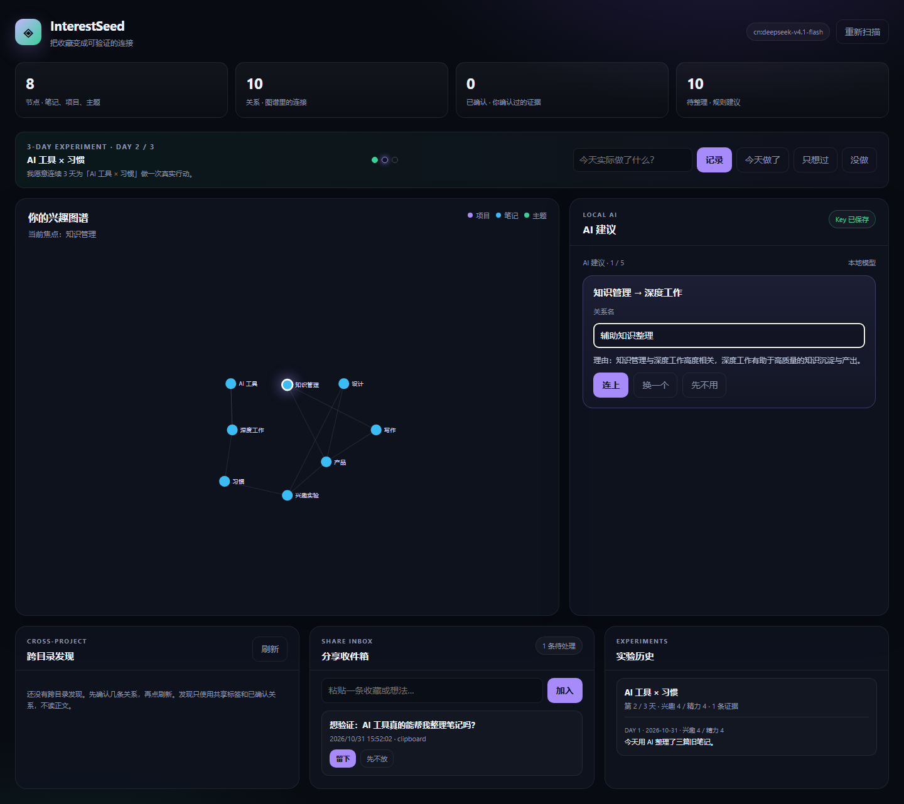

<div align="center">

<h1>InterestSeed</h1>

<p><strong>本地优先的兴趣验证器</strong></p>

<p>把一条收藏，变成 3 天真实行动；<br/>再用证据决定：继续，还是放下。</p>

<p>读取任何 Markdown vault，独立运行。</p>

<p><strong>本地 AI，一次只给一条能验证的连接。</strong></p>



<p>
  <a href="assets/interestseed-launch.mp4"></a>
  
  
  
  
  
  
  
</p>

<p>
  <a href="README.en.md">English</a> ·
  <a href="assets/interestseed-launch.mp4">40 秒演示</a> ·
  <a href="docs/ai.md">AI 建议</a> ·
  <a href="docs/tutorial.md">完整教程</a> ·
  <a href="docs/positioning.md">产品定位</a> ·
  <a href="https://github.com/lxc248/-interestseed/releases">下载</a>
</p>

</div>

---

> 大多数工具帮你**存下来**。  
> InterestSeed 帮你**验一下**。

我们并不缺收藏。缺的是收藏之后，真的做一次，然后诚实地说一句：还行，或者算了。

## AI 是核心，不是附加功能

大多数 AI 功能给你一个聊天框。InterestSeed 的 AI 只做一件事：从你的图谱里挑一条最值得验证的连接。

```text
一条收藏 → AI 给一条建议 → 连上 / 换一个 / 先不用 → 3 天实验
```

- 只给一条，不给你一屏“待确认”
- 带一句理由，关系名可以改
- 连上后才写入，写入后可撤销
- 只发节点 id、标题、标签
- 使用你自己的本地模型和 Key

### AI 和 Obsidian 怎么接

- 当前笔记右键 →「用 AI 找这条笔记的连接」
- 命令面板 →「从当前笔记找 AI 连接」
- 图谱选中节点 →「从选中节点找连接」
- 左侧文件树右键同样可以发起
- AI 侧边栏常驻右侧，不打断编辑
- 连上 / 换一个 / 先不用，连上后可撤销

[AI 建议是怎么工作的 →](docs/ai.md)

## 独立版：不再只是 Obsidian 插件

InterestSeed 现在可以脱离 Obsidian 运行。Obsidian vault 只作为 Markdown 数据层。

```text
CLI        scan / suggest / connect / serve
Local Web  图谱、AI 单条建议、撤销
Skill      Agent 可直接调用
Storage    <vault>/.interestseed/
```

```bash
npm run build:standalone
node standalone/dist/cli.js init --vault "<vault>"
node standalone/dist/cli.js serve --vault "<vault>" --port 4173
```

[独立版文档 →](docs/standalone.md) · [Agent Skill →](standalone/skill/SKILL.md) · [CLI →](standalone/README.md)

## 它和收藏夹到底差在哪

| | 收藏夹 | 双向链接笔记 | **InterestSeed** |
| --- | --- | --- | --- |
| 回答的问题 | 存在哪 | 和什么相关 | **值不值得做** |
| 成功标准 | 收集数量 | 连接数量 | **完成一次真实验证** |
| 结束状态 | 待读 | 一张网 | **继续 / 放下 + 下一步** |
| 默认动作 | 保存 | 链接 | **做一个小实验** |

收藏夹解决“别丢”，InterestSeed 想解决“别假装自己会做”。

它不优化“节点数”，它优化**决策完成率**。

## 它是怎么跑起来的

一条内容进来，只走一条路。

```text
Capture → Decide → Connect → Verify → Review → Next action
```

| 阶段 | 发生什么 |
| --- | --- |
| **Capture** | 分享收件箱接收短视频链接、文章摘录或笔记，一次只处理一条 |
| **Decide** | 留下并连接，或路过；路过也是有效决定 |
| **Connect** | 留下的小火花连接到已有兴趣，或长成新的兴趣 |
| **Verify** | 3 天 starter experiment，每天记录一次真实行动 |
| **Review** | 追加式观察时间线，记录证据与信念方向 |
| **Next action** | 显式生成 Markdown 兴趣路线，写清状态、证据和下一步 |

图谱不是产品，它是让每个决定可复查的**证据层**。

## 它长这样

先看 AI，再看全貌。

<table>
  <tr>
    <td width="50%">
      <br/>
      <sub><b>3 分钟冷启动</b>：不需要先知道自己喜欢什么。</sub>
    </td>
    <td width="50%">
      <br/>
      <sub><b>3 天实验</b>：每天一条真实证据，不自动编进度。</sub>
    </td>
  </tr>
  <tr>
    <td width="50%">
      <br/>
      <sub><b>宇宙图谱</b>：节点、轨道、桥接与下一步。</sub>
    </td>
    <td width="50%">
      <br/>
      <sub><b>本地分享卡</b>：五种平台规格，Canvas 本地渲染。</sub>
    </td>
  </tr>
</table>

## 你实际会用到什么

下面不是功能清单，是我每天真的会碰到的几个动作。

| 能力 | 说明 |
| --- | --- |
| **一次一条** | 分享收件箱支持列表与专注模式；`←` 路过，`→` 留下，不做批量处理 |
| **来源溯源** | 每条记录保留 source / sourceRef / capturedAt / status，可回到原笔记或外链 |
| **兴趣任务状态** | `captured → judged → connected → experimenting → reviewed`，由元数据与连接确定性推导 |
| **观察时间线** | 追加式证据，记录 `stronger / weaker / changed` 与日期，最多 40 条 |
| **3 天验证** | 时间盒实验，只记录真实发生的事，没有自动完成 |
| **上下文搜索** | 标题、标签、摘要、为什么、原文、来源路径、观察证据，多字段确定性搜索，无需 embedding |
| **兴趣路线** | 显式命令生成 Markdown MOC，从不自动写笔记 |
| **五种分享卡** | 小红书、Instagram、X、微信、Story，全部本地 Canvas 渲染 |
| **AI 建议** | 默认开启；只使用你自己的本地模型；一次只给一条；可改关系名；连上后可撤销；默认 `cn:deepseek-v4.1-flash` |
| **MCP 接口** | 零依赖只读 MCP server，协议 `2026-07-28` |
| **自适应布局** | 桌面、窄栏、极窄栏三档，图标优先，不横向溢出 |

## 装起来

### 独立版（推荐）

也可以直接从 [Releases](https://github.com/lxc248/-interestseed/releases) 下载 `interestseed-standalone-v4.0.0.zip`。

```bash
npm run build:standalone
node standalone/dist/cli.js init --vault "<vault>"
node standalone/dist/cli.js serve --vault "<vault>" --port 4173
```

Web：`http://127.0.0.1:4173`

### Obsidian 插件（兼容）

1. 从 [Releases](https://github.com/lxc248/-interestseed/releases) 下载 `interestseed-v3.7.0.zip`。
2. 解压到：

```text
<your-vault>/.obsidian/plugins/interestseed/
```

3. 确认目录里有 `main.js`、`manifest.json`、`styles.css`。
4. Obsidian → 设置 → 第三方插件 → 启用 **InterestSeed**。
5. 运行冷启动问卷，或记录第一条火花。
6. 处理分享收件箱，然后开始 3 天实验。

完整走查：[docs/tutorial.md](docs/tutorial.md)

## MCP

```bash
# 独立版
node mcp/server.mjs --graph "<vault>/.interestseed/state.json"

# Obsidian 插件兼容
node mcp/server.mjs --graph "<vault>/.obsidian/plugins/interestseed/graphs/default.json"
```

```text
tools:      interestseed_get_graph / next_step / search_interest / get_experiment / get_context
resources:  interestseed://graph / experiment / next / context
prompts:    review-interest / plan-next-experiment
```

MCP 是只读的。核心功能不需要账号或模型凭据。  
AI 关系建议默认开启，只在你点击 AI 时请求所选模型；接入引导窗口可以填写自己的本地服务 Key，模型 ID 可在设置里改成服务实际暴露的 ID；密钥存进 Obsidian 安全存储，不进入 data.json。不可用时会自动保留本地规则发现。  
本地实测：`cn:deepseek-v4.1-flash` 返回 5 条聚焦候选，确认后写入图谱，理由进入关系证据。  
候选确认前可以改关系名；写入后弹窗会给出撤销按钮，不会留下无法解释的“已接受”。

## 我把它做得多稳

这些数字不是装饰。每次改完，我都会重新跑一遍。

```text
530 tests passing
75.43% line coverage
92.25% core coverage
46.53% UI coverage
axe: graph / inbox / share-card 0 violations
semgrep: 0 findings
gitleaks: no leaks
CI + Release: green
```

```bash
npm install
npm run verify      # typecheck + tests + lint + build
npm run coverage
node --test mcp/smoke.test.mjs
```

要求 Node.js 22+。

## 几条不肯让步的原则

```text
Human-in-the-loop
Local-first
Explicit over automatic
Evidence over volume
Deterministic retrieval
```

InterestSeed 不抓取平台、不保存 cookie、不自动发布、不自动写图谱、不自动生成路线。  
决定权始终在用户手里。

## 文档

| 文档 | 内容 |
| --- | --- |
| [docs/architecture.md](docs/architecture.md) | 模块地图、数据流、不变量与扩展点 |
| [docs/tutorial.md](docs/tutorial.md) | 端到端使用教程 |
| [docs/positioning.md](docs/positioning.md) | 产品定位与竞品分析 |
| [docs/seed-sprint.md](docs/seed-sprint.md) | 冷启动设计 |
| [docs/view-modes.md](docs/view-modes.md) | 图谱 / 收件箱 / 发现三种视图的不变量 |
| [docs/context-packet.md](docs/context-packet.md) | 数据模型与任务状态 |
| [docs/share-cards.md](docs/share-cards.md) | 分享卡导出行为 |
| [docs/commands.md](docs/commands.md) | 命令面板参考 |
| [SECURITY.md](SECURITY.md) | 安全模型与漏洞披露 |

## License

AGPL-3.0-only. Author: [aicoder](https://github.com/lxc248).

如果你也有过“收藏了就等于学了”的错觉，欢迎试试它。  
觉得有用就 star；发现问题就提 issue；想一起改，先读 [CONTRIBUTING.md](CONTRIBUTING.md) 和 [CODE_OF_CONDUCT.md](CODE_OF_CONDUCT.md)。


